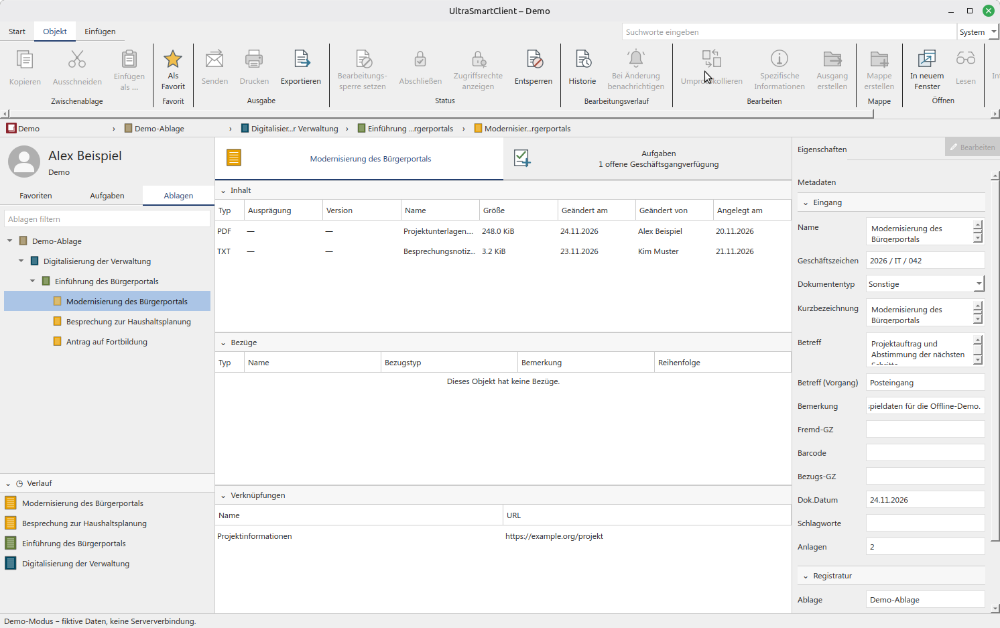
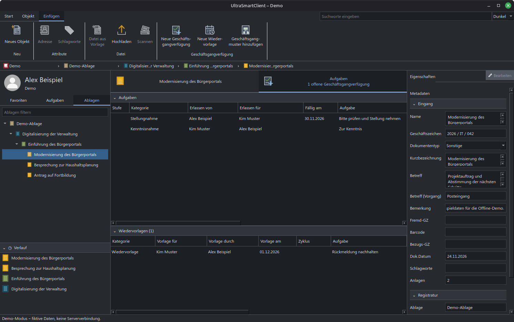

# VIS-UltraSmartClient

Ein ultra-smarter Desktop-Client für VIS - endlich schnell und plattformübergreifend!

- gewohnt einfache, aber performante & plattformübergreifende Oberfläche
- Dark-Mode
- Kerberos-Authentifizierung
- verwendet die VAPI




## Installation & Start

### Paket

Das entsprechende Installationspaket aus den [Github-Releases](https://github.com/schorschii/VIS-UltraSmartClient/releases) herunterladen und starten.

### Manuell

```bash
# Ubuntu system packages
apt install python3-pyqt6 python3-requests python3-requests-gssapi python3-gssapi python3-defusedxml
python3 -m ultrasmartclient

# or inside a venv
python3 -m venv venv
venv/bin/pip install .
venv/bin/python3 -m ultrasmartclient
```

### Python-Modul

Ein Wheel lässt sich mit `python -m pip wheel --no-deps . --wheel-dir dist` bauen.

## Demo-Modus

```bash
python3 -m ultrasmartclient --demo
```

Öffnet das Hauptfenster ohne Anmeldung und Serververbindung mit fiktiven Dokumenten, Metadaten, Anlagen, Aufgaben und Wiedervorlagen, z.B. für Screenshots. Die Dokumente lassen sich im Baum auswählen.

## Mandanten

Die Liste und die letzte Auswahl werden in `~/.config/ultrasmartclient/tenants.json` gespeichert. Zusätzlich werden systemweit konfigurierte Mandanten aus `/etc/ultrasmartclient/tenants.json` geladen. Die Anzeige folgt der Reihenfolge der Systemkonfiguration; nur persönlich konfigurierte Mandanten folgen danach in ihrer Dateireihenfolge. Persönliche Einträge für dieselbe URL überschreiben weiterhin die Angaben der Systemkonfiguration.

Beide Dateien verwenden das gleiche Format, zum Beispiel:
```json
{
    "tenants": [
        {"name": "Produktion", "server_url": "https://vis.example.org/vis/PROD"}
    ],
    "selected": 0
}
```

## Authentifizierung

Die Authentifizierung nutzt `requests-gssapi` mit Kerberos und dem vorhandenen Ticket-Cache (`klist` zur Prüfung, optional `KRB5CCNAME` für einen anderen Cache). Passwörter werden nicht gespeichert. Linux benötigt Kerberos/GSSAPI-Bibliotheken, zum Bauen des Python-Moduls ggf. `libkrb5-dev`, `python3-dev` und einen C-Compiler.

Eine geteilte Requests-Session nutzt das vorhandene Session-Cookie, um nicht jede Anfrage neu zu authentifizieren. Dadurch läuft dieser Client deutlich schneller als das Original. Falls Ihr weitere Optimierungsgeheimtipps braucht, liebe Entwickler, meldet euch gerne bei mir. Ich helfe wo ich kann.

HTTPS-Zertifikate werden geprüft, für eine interne CA kann `REQUESTS_CA_BUNDLE` auf die PEM-Datei zeigen.

HTTP-Weiterleitungen werden nicht automatisch verfolgt. Verbindungs- und Lese-Timeouts betragen 10 bzw. 30 Sekunden.

## SOAP-Debugausgabe

Mit `--debug` werden die vollständigen SOAP-Anfrage- und Antwort-Bodys auf stdout ausgegeben, jeweils mit Endpunkt und bei Antworten HTTP-Status. Auch Fehlerantworten erscheinen vor ihrer Verarbeitung in der Ausgabe.

## Tests

```bash
QT_QPA_PLATFORM=offscreen venv/bin/python -m unittest discover -s tests -v
```

Die Tests prüfen Beispielantwort, SOAP-Fehler, Request/Auth-Konfiguration sowie GUI-Updates bei Erfolg und Fehler mit simuliertem Backend sowie Mandantenverwaltung und Konfigurationsspeicherung in temporären Verzeichnissen. Der Smoke-Test führt keine Serveranfrage aus. Ein echter Kerberos-Test benötigt Server und gültiges Ticket.

## Offscreen-Prüfung

```bash
QT_QPA_PLATFORM=offscreen venv/bin/python -m ultrasmartclient --smoke-test
```

Prüft Fensteraufbau, Ribbon-Wechsel, Anwendungssymbol, Suche, Metadaten und Anlagen. Erzeugt eine Vorschau unter `/tmp/ultrasmartclient-pyqt6.png`.
